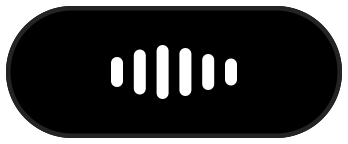

# V0.3.0 validation

Tag `v0.3.0` targets tested source `48e1ae4a0b0f638d226448453246202e21ce00d2`. Both jobs passed in [GitHub run 40643506214](https://github.com/CaillouMalade/Murmure/actions/runs/40643506214). Earlier milestone tags are unchanged. Documentation-only commits after the tag record this evidence; no GitHub release was published.

## Automated checks

- All 21 worker tests passed on Windows, including real OS process breakaway/lifetime/refusal checks and the new foreground dictation success, busy-model and duplicate-result cases.
- On macOS, 19 worker tests passed and the two Windows-only lifetime tests were skipped.
- All 20 Swift tests passed: six existing core tests, 11 workflow tests, two native indicator tests and one settings rendering/layout test. These include old-preference/history migration, Markdown preservation, stdin/argument handling with executable CLI fixtures, Claude error parsing, process timeout/cancellation, blocked stdin, inherited output descriptors and excessive output limits.
- Both platforms installed the pinned worker requirements and passed genuine native imports and generated-silence decoding without downloading model weights.
- The runner built both arm64 and x86_64 release binaries, created the universal `.app`, checked its permissions/URL-scheme metadata and exercised the bundled Python worker protocol.
- Native indicator and all three settings tabs rendered to PNG without activating a window. Downloaded previews were visually inspected against the supplied six-bar capsule reference. This caught cramped path fields, which were corrected and rechecked. Reduce Motion and removal of repeating animations at idle are covered; live animation smoothness is not.

## Actual inference

A separate opt-in test on the Windows G14 used synthetic English speech encoded to M4A, a public `tiny.en` model and CPU/int8. A real foreground RPC subprocess returned a completed transcript with no mocked inference:

> Murmur keeps the recording safe. The remote computer transcribes it while the Mac can sleep.

Test job `efaa5e45-9ba2-42c8-8d8e-c990463c2ab1` is under the ignored `.build/dictation-smoke` directory. The model cache and venv are not shipped. The invocation was:

```text
.venv/Scripts/python.exe scripts/smoke-worker.py --foreground --audio .build/smoke-input/synthetic.wav --root .build/dictation-smoke
```

No private recording, provider key or paid provider inference was used. This proves the foreground worker/inference path on Windows, not a Mac-to-G14 SSH session.

## Inspected download

`dist/final-v0.3.0/Murmure-0.3.0-macOS.zip` was downloaded from the passing run and inspected locally for version `0.3.0`, build `3000`, the matching v0.3 worker/foreground operation, executable permissions and both Mach-O architectures.

- ZIP size: 694,939 bytes.
- SHA-256: `4f000a225dbc4bb599f077a4f63a08e8560b96581bd8f4c3ca880b971bd50286`.
- The app directory measured 2.2 MiB on the runner. This is disk size, not RAM or energy use; Python/model and external CLI installations are separate.
- The development bundle is not Developer ID signed or notarized, as in the earlier milestones.

## Still unverified

Development runs on Windows. A real Mac must check microphone/system capture, Accessibility permissions, focus/selection guards, Unicode delivery in specific editors, global shortcut press/release, command focus, Apple on-device recognition, and actual animation/energy behavior. [MAC_TESTING.md](MAC_TESTING.md) records those checks.

The existing strict unknown-host SSH preflight refusal remains unresolved; no host key or SSH policy was changed, and no live Mac-to-G14 connection is claimed. No real Codex/Claude account inference was invoked; documentation and executable fixtures verify the integration contract, while actual CLI version/login/provider behavior needs checking on the Mac. Speaker diarization quality, native idle RAM/battery and signing/notarization are also unverified.

The native capsule preview below is rendered from the app's own view at six times its menu-bar size. It is a static rendering, not a screenshot from Arthur's Mac.


